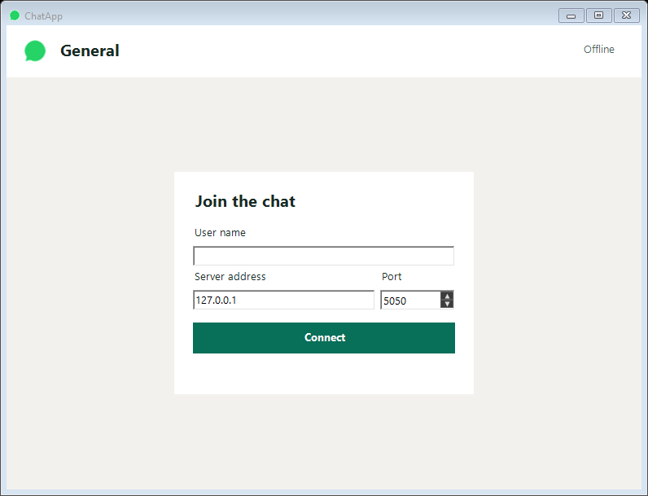
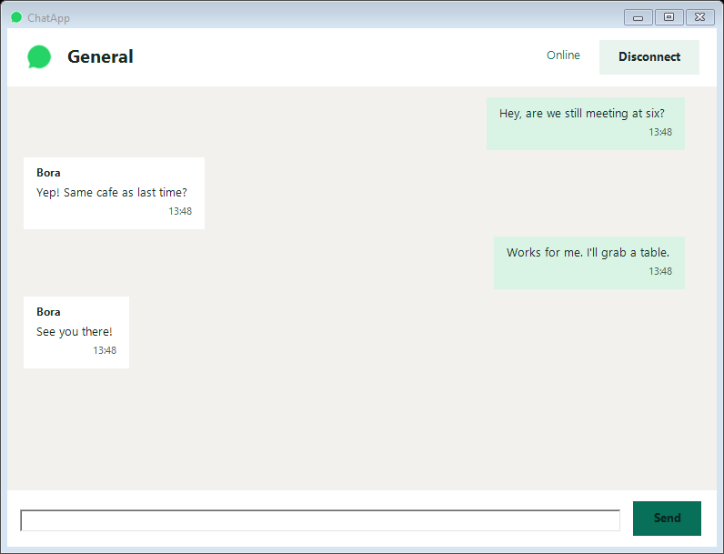

# ChatApp

ChatApp is a desktop messaging application with a C# Windows Forms client and an Elixir TCP server. Users join a shared room with a display name and exchange timestamped messages in real time.

## Technologies

- C# and .NET 10 with Windows Forms and `TcpClient`
- Elixir 1.19 and Erlang/OTP 28 with `:gen_tcp` and `GenServer`
- UTF-8, newline-delimited JSON over TCP

## Run locally

The client requires Windows and the .NET 10 SDK. The server requires Elixir 1.19 with Erlang/OTP 28. The project uses the standard libraries on both sides.

In a PowerShell terminal at the repository root, start the server:

```powershell
Set-Location server
mix run --no-halt
```

In a separate terminal at the repository root, launch the client:

```powershell
dotnet run --project ChatApp.Client/ChatApp.Client.csproj
```

Run the client command again in a third terminal. Enter a different display name in each client and connect to `127.0.0.1` on port `5050`. Press Enter or select **Send** to send a message. Select **Disconnect** to leave the room. The server console shows the connected users as they join and leave.

## Project structure

| Path | Responsibility |
| --- | --- |
| `ChatApp.Client/` | Windows Forms interface, message rendering, and TCP client |
| `server/` | Elixir listener, connection handling, and shared chat room |
| `docs/screenshots/` | Screenshots of the running client |

## Current limitations

The server listens on loopback by default. It supports one shared room, and a display name identifies the connection only for that session. Messages are not stored on the server. The TCP connection is unencrypted.

## Screenshots

**Join screen**



**Shared conversation**


