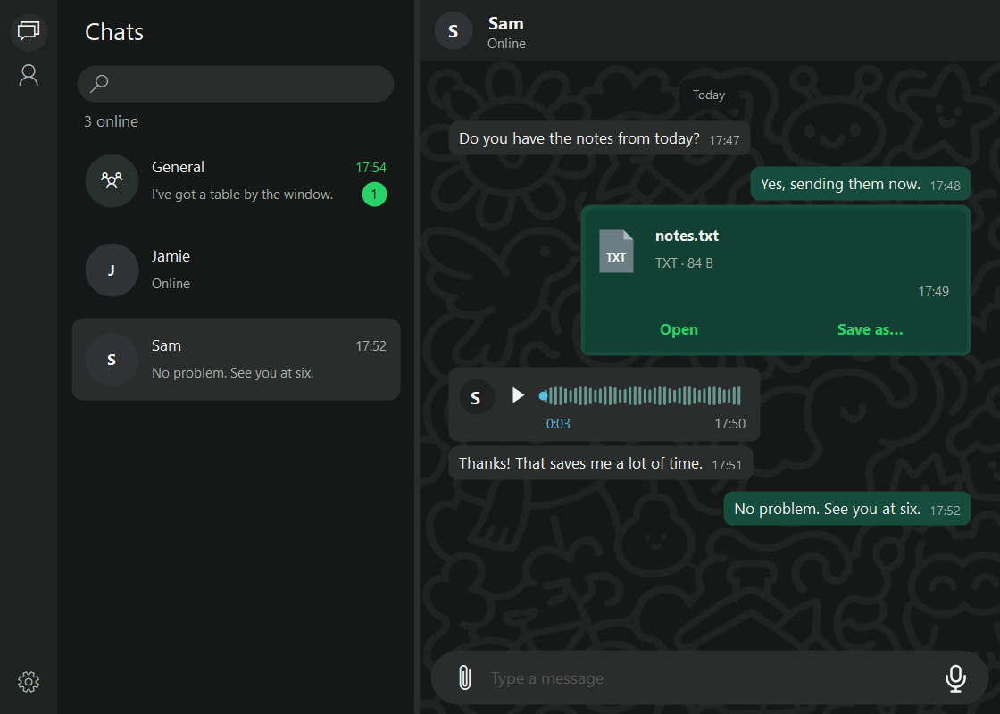

#  ChatApp

A dark-themed Windows desktop messenger built with C# and an Elixir TCP server. Chat in a shared room or privately, exchange files and voice messages, and preview images without leaving the application.

## Features

- **Shared and private conversations** with online status, unread counts, message previews and a separate draft for each conversation.
- **Resizable chat sidebar** with search by conversation name or latest message. Narrow windows switch between the conversation and the chat list using a back arrow.
- **Message groups and date separators**, with compact timestamps and wrapping for long messages.
- **File sharing** through the paperclip button or drag and drop. Dropped files are reviewed before sending; remove unwanted or invalid entries, then choose **Send**, or cancel with **Esc**.
- **Attachment cards** showing the file name, type and size, with **Open** for supported types and **Save as…**.
- **Image previews** with an in-app viewer. Zoom with the mouse wheel or **+ / −**, drag a zoomed image to pan, and fit it to the window using the percentage button, **Home** or **Ctrl+0**. **Esc** closes the viewer.
- **Voice messages** with microphone recording, pause/resume, discard and send controls. Received messages have inline playback, waveform progress and a save option in the context menu.
- **Consistent button feedback** and a fixed doodle wallpaper that stays in place while messages scroll and the window is resized.

## Technologies

- C# and .NET 10 with Windows Forms, `TcpClient` and Windows multimedia APIs
- Elixir 1.19 and Erlang/OTP 28 with `:gen_tcp`, `GenServer` and supervision
- UTF-8, newline-delimited JSON over TCP; file attachments use Base64 and voice recordings are transferred in chunks
- Standard .NET, Elixir and Erlang libraries; no external application packages

## Run from source

The client requires **Windows and the .NET 10 SDK**. The server requires **Elixir 1.19 and Erlang/OTP 28**.

From the repository root, start the server in a terminal:

```powershell
Set-Location server
mix run --no-halt
```

In a separate terminal at the repository root, start a client:

```powershell
dotnet run --project ChatApp.Client/ChatApp.Client.csproj
```

Run the client command in another terminal to open a second session. Enter different display names and connect both clients to **127.0.0.1**, port **5050**. Keep the server running while chatting.

To build the client without launching it:

```powershell
dotnet build ChatApp.Client/ChatApp.Client.csproj
```

## Using the app

1. Select **General** to message everyone connected to the server, or select a person for a private conversation.
2. Type a message and press **Enter** or click the send icon. The microphone button appears when the text field is empty.
3. Use the paperclip to select a file, or drop one or more files onto the open conversation. Dragged files open a review window and are sent only after confirmation.
4. Click the microphone to record. Pause or resume as needed, discard with the trash button, or send with the green arrow. Recording has no fixed time cutoff; WAV format limits and available disk space still apply.
5. Drag the divider to resize the sidebar. On narrow windows, use the back arrow to return to the chat list and select a conversation to reopen it.
6. Open **Settings** from the gear at the bottom of the navigation rail to disconnect or view the current connection details.

File attachments must be non-empty and no larger than **10 MB each**. Folders are not sent. Drag-and-drop preparation is unavailable while recording or sending. A dropped batch is sent sequentially; an error stops the remaining files and reports how many were sent.

If a person goes offline, their conversation remains visible, but sending is disabled until they reconnect with the same display name. Reconnecting your own client starts a fresh local session.

## Run on a local network

On the server computer, bind to its local IPv4 address before starting Mix. The address below is an example:

```powershell
Set-Location server
$env:CHAT_BIND = "192.168.1.20"
$env:CHAT_PORT = "5050"
mix run --no-halt
```

Clients on the same network should enter the server computer's address and port. Allow incoming TCP connections to that port in the server computer's firewall as needed.

| Server setting | Default | Purpose |
| --- | --- | --- |
| `CHAT_BIND` | `127.0.0.1` | IPv4 address to listen on |
| `CHAT_PORT` | `5050` | TCP listening port |

If the port is already in use, reuse the existing ChatApp server or choose another port. Clients must use the same port as the server.

## Project structure

| Path | Responsibility |
| --- | --- |
| `ChatApp.Client/Program.cs` | Windows application entry point |
| `ChatApp.Client/ChatForm.cs` | Connection, conversations and responsive window layout |
| `ChatApp.Client/ChatForm.Attachments.cs` | Drag-and-drop targets, review flow and sequential sending |
| `ChatApp.Client/ChatConnection.cs` | TCP connection, JSON packets and voice transfer |
| `ChatApp.Client/Conversation.cs` | Per-conversation history, draft, presence and unread count |
| `ChatApp.Client/MessageFeed.cs`, `MessageScrollBar.cs` | Message layout, grouping, dates and scrolling |
| `ChatApp.Client/ChatAttachment.cs`, `AttachmentCandidate.cs` | File encoding, metadata and validation |
| `ChatApp.Client/AttachmentDropOverlay.cs`, `AttachmentReviewDialog.cs` | Drop target and attachment preparation UI |
| `ChatApp.Client/FileAttachmentCard.cs`, `ImageMessageCard.cs`, `VoiceMessageCard.cs` | Attachment and media cards |
| `ChatApp.Client/ImageViewer.cs`, `ZoomImageCanvas.cs` | Full image display, zoom and pan |
| `ChatApp.Client/MicrophoneRecorder.cs`, `WaveInput.cs`, `VoiceAudio.cs` | Microphone capture, WAV handling and playback |
| `ChatApp.Client/VoiceRecordingBar.cs`, `VoiceLevel.cs`, `RecordingButton.cs` | Recording controls and live level display |
| `ChatApp.Client/InteractiveButton.cs`, `InteractionFeedback.cs`, `NavigationButton.cs` | Button states, navigation and keyboard focus styling |
| `ChatApp.Client/ChatTheme.cs`, `ChatWallpaper.cs`, `ConversationAvatar.cs` | Theme, fixed wallpaper and conversation avatars |
| `ChatApp.Client/Assets/` | Embedded application icon and wallpaper |
| `server/lib/chat_app.ex` | Listener, connections, room membership and message routing |
| `docs/` | README icon and application screenshots |

## Current limitations and data handling

- Display names identify users for the session; there are no authenticated accounts. The server listens on loopback by default, and the TCP connection is **unencrypted**.
- Conversation histories and drafts are kept in client memory and reset on reconnection or exit. The server does not persist message history; its console logs connection activity.
- Voice recording and playback use Windows APIs. Microphone access must be allowed in Windows settings. Recordings, incoming voice messages and files opened in another application can create temporary files; saving an attachment creates a copy at the chosen location.
- In-app file previews cover supported images. Documents and videos use file cards and external applications rather than embedded document rendering or video playback. The image viewer displays one image at a time.

## Screenshots

The screenshots use fictional conversations and generated sample audio.

**Join a server**


**Shared conversation**


**Private conversation and attachments**


